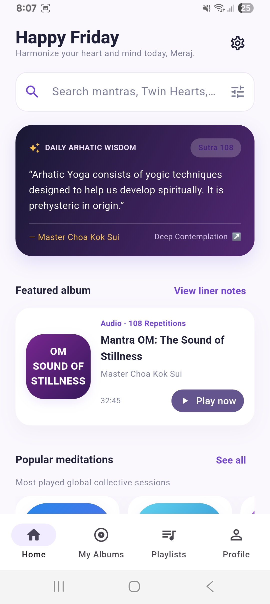
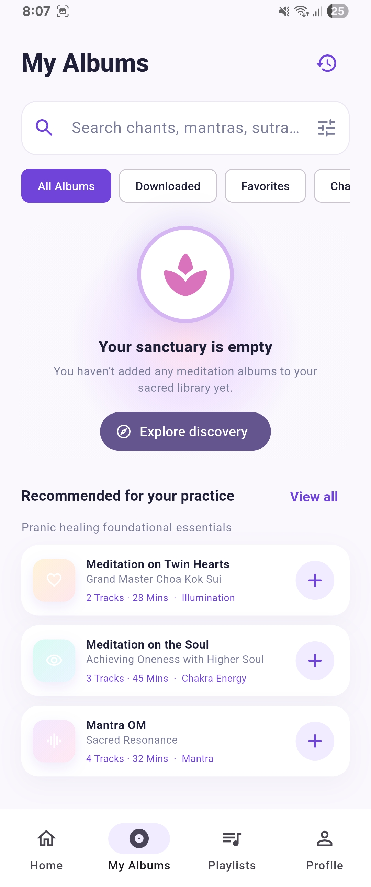
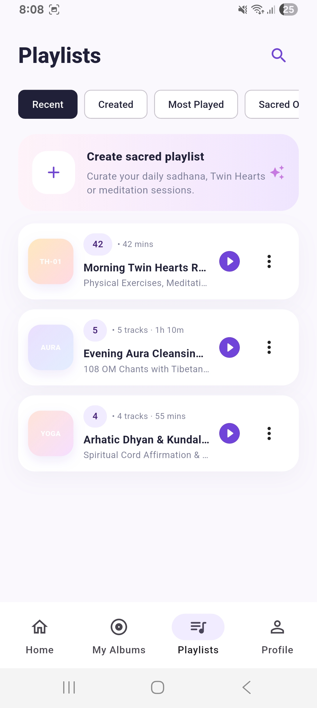
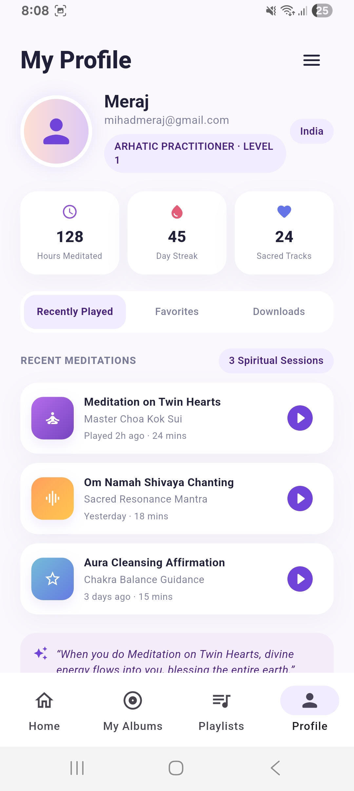
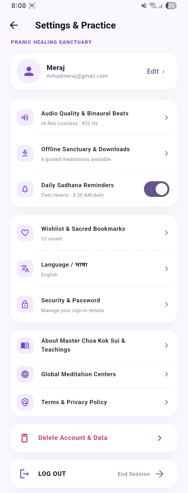

# Sanctuary Mobile Application

Sanctuary is a meditation and sacred audio app built with Flutter. It takes users through onboarding and account setup, then brings Home, My Albums, Playlists, Profile, and Settings together in one mobile app.

## Product overview

I focused on carrying the same visual style across the main screens and connecting the account flow to Firebase. Riverpod handles app-level state, while SharedPreferences remembers onboarding completion and a few local preferences.

## Features

- Three-step welcome flow with locally saved onboarding completion.
- Firebase email/password registration, sign-in, password reset, sign-out, and profile name updates.
- User profile records stored in Cloud Firestore under `users/{uid}`.
- Four primary app tabs: Home, My Albums, Playlists, and Profile. Settings is available from the profile screen.
- Search, filter, playlist, album, profile, and settings interfaces based on the supplied screen references.
- Local preview mode when Firebase is not configured. Preview sessions and selected preferences use SharedPreferences.
- Loading, validation, error, empty-library, and confirmation feedback for the flows implemented in the app.

Audio playback, remote downloads, scheduled reminders, language translation, and account deletion are interface demonstrations; they do not connect to a media catalogue or backend service.

## Screenshots

Captured from the app running on an Android phone.

| Home | My Albums |
| --- | --- |
|  |  |

| Playlists | Profile |
| --- | --- |
|  |  |

| Settings |
| --- |
|  |

## Development setup

- Flutter stable (Dart 3.11 or later)
- Android Studio with Android SDK and an Android device or emulator
- A Firebase project with an Android app registered as `com.indosakura.iismobile`

The project was developed with Flutter 3.47.5, Dart 3.13.4, Android SDK 36, and Android Studio 2026.2.1.8.

## Run locally

1. Clone the repository and open its project directory.
2. Add the Firebase Android configuration file at `android/app/google-services.json` if Firebase sign-in is required. This file is intentionally excluded from version control.
3. Fetch packages and start the app:

   ```powershell
   flutter pub get
   flutter run
   ```

If the Firebase configuration is absent or Firebase initialization fails, the app opens in local preview mode. Preview accounts are stored on the device; passwords are not saved.

## Firebase configuration

The Android application uses Firebase project `iis-mobile-application`, with Email/Password authentication and Cloud Firestore in `asia-south1` (Mumbai). For another Firebase project, register the Android package `com.indosakura.iismobile`, download its `google-services.json` into `android/app/`, and enable Email/Password in Firebase Authentication.

The app writes a profile document at `users/{uid}` with these fields:

| Field | Description |
| --- | --- |
| `uid` | Firebase Authentication user ID |
| `email` | Account email address |
| `displayName` | Profile display name |
| `onboardingComplete` | Whether onboarding is complete |
| `createdAt` | Profile creation timestamp |
| `updatedAt` | Most recent profile update timestamp |

The included `firestore.rules` lets signed-in users read and write only their own `users/{uid}` document. For a different Firebase project, publish these rules with the Firebase CLI or Firebase Console. iOS and web need their own Firebase configuration before use.

## Project structure

```text
lib/
  main.dart                         Firebase initialization and app startup
  src/
    app.dart                        App theme and first-launch/session gate
    application/providers.dart      Riverpod onboarding and session state
    core/                           Shared theme and Firebase status
    data/auth_repository.dart       Firebase Auth, Firestore, and preview storage
    domain/models/app_user.dart     User model
    presentation/                   Screens and shared widgets
test/
  onboarding_provider_test.dart     Onboarding persistence tests
firestore.rules                     User-scoped Firestore access rules
```

Riverpod manages app-level onboarding and session state. Screens use Flutter widgets for screen-local form and interaction state. SharedPreferences stores onboarding completion, preview session data, and selected local preferences.

## Packages used

- `flutter_riverpod` keeps onboarding and sign-in state available across the app.
- `firebase_core` initializes Firebase on Android.
- `firebase_auth` handles email/password accounts and password reset.
- `cloud_firestore` stores each user's profile.
- `shared_preferences` saves onboarding completion and lightweight local preferences.
- `flutter_test` and `flutter_lints` support automated checks and consistent Dart style.

## Checks

Run the analyzer and automated tests:

```powershell
flutter analyze
flutter test
```

The onboarding tests cover the initial state, saving completion, and restoring a saved completion flag.
